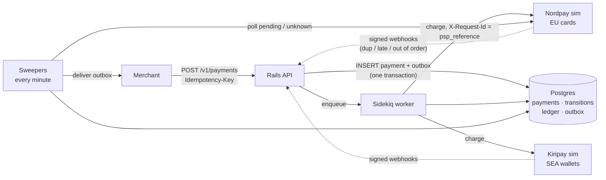
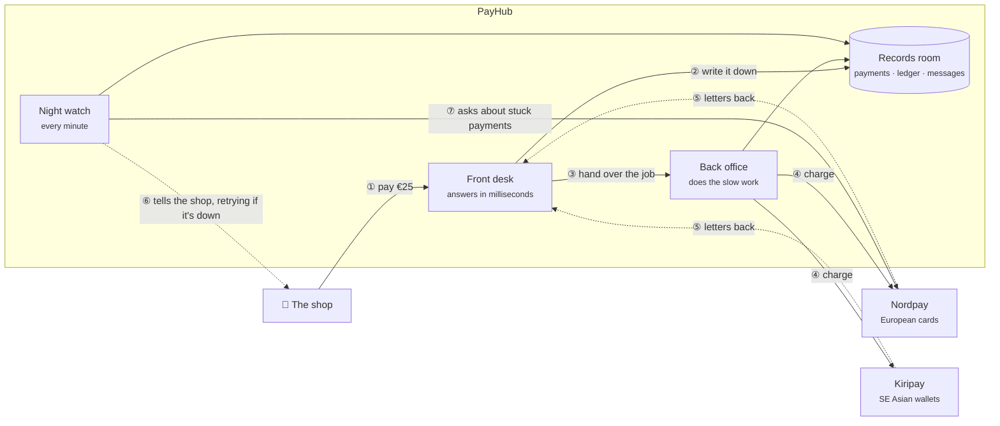
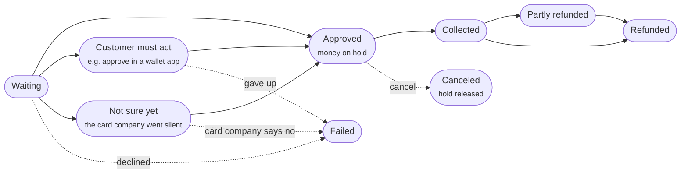
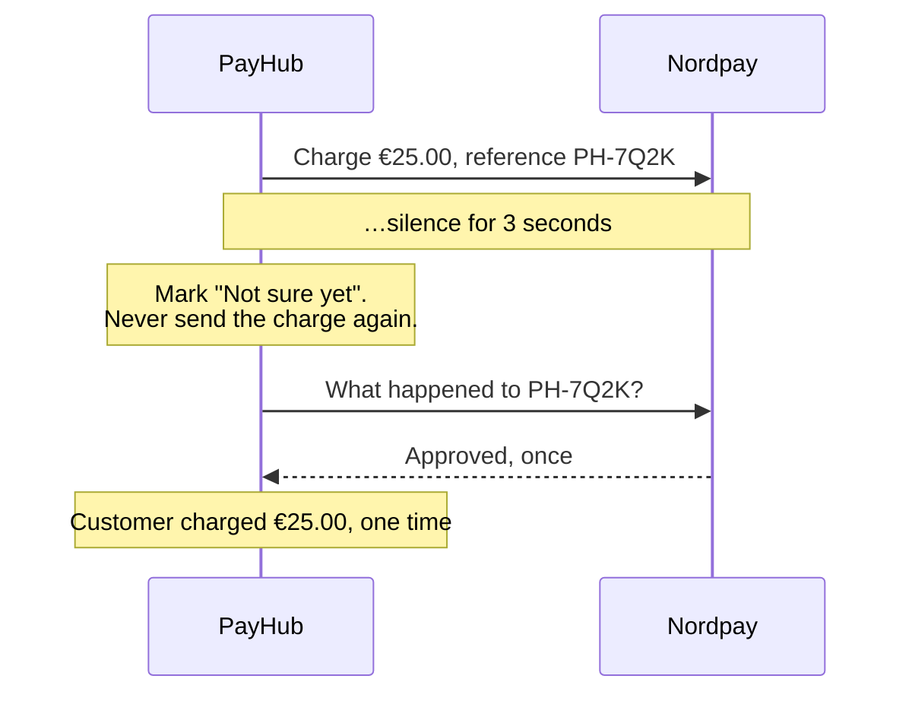
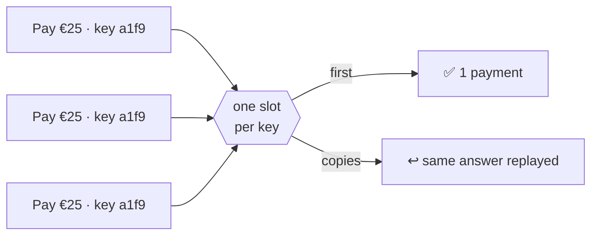
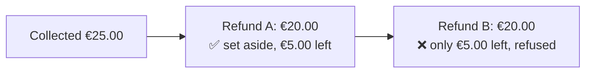
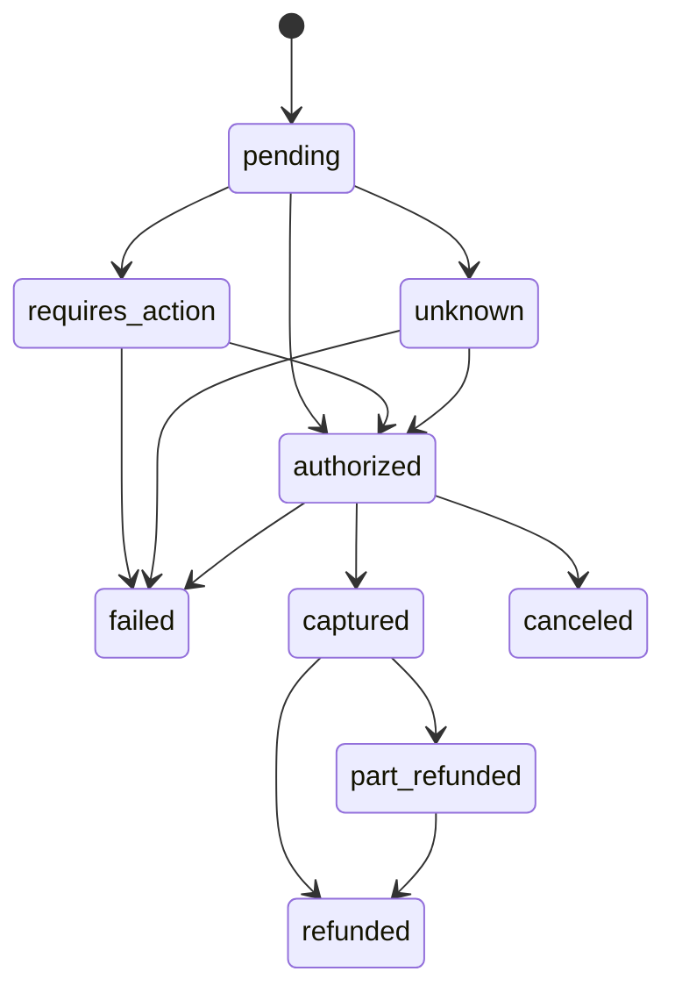

# PayHub

[](https://github.com/baobeta/payhub/actions/workflows/ci.yml)


[](LICENSE)

A payment orchestration API. Merchants integrate once; PayHub routes each payment to one of two deliberately unreliable PSP simulators and keeps one consistent view of money movement.

**The one rule:** no customer is ever charged twice, and no merchant is ever refunded more than they captured — under timeouts, duplicate webhooks, concurrent requests, worker crashes and PSP outages. Every design choice serves it; [DECISIONS.md](DECISIONS.md) records the twenty-six that mattered, each with the trade-off it accepts, and [RUNBOOK.md](RUNBOOK.md) is what you read at 3am.

### What's worth a look

- **Timeouts become `unknown`, not retries.** A charge the PSP might have taken is never re-sent blind; it's resolved by status poll or webhook, using a reference we wrote *before* the call.
- **Idempotency decided by a unique index**, not a `SELECT`: three concurrent copies of one request make exactly one payment.
- **An append-only double-entry ledger** — a trigger rejects `UPDATE`/`DELETE`; every balance is a `SUM` over rows.
- **Two hostile PSP simulators** that time out, 500, duplicate responses and send webhooks late, twice, out of order, badly signed or never.
- **[`bin/rails chaos:run`](#chaos-run-the-one-rule-live)** turns them up and checks the ledger against the PSP's own records; a **seeded deterministic simulation** does the same in-process, replayably, and found two bugs the specs had missed.
- **Settlement-file reconciliation**: the PSP's daily payout report is matched line by line to the ledger — fees booked, receivables cleared, and anything the PSP paid that we never booked flagged.
- **Keyset pagination proven at 1M rows**, OpenTelemetry traces across HTTP → Sidekiq → PSP, Sorbet-typed adapters.

<p align="center"></p>



## PayHub in plain words

> This section is for readers without a technical background: product, operations, finance, leadership, new teammates. Engineers will find the detail from [Run it](#run-it) onwards and in [DECISIONS.md](DECISIONS.md).

PayHub sits between online shops and the companies that actually move card and wallet money. A shop connects to PayHub once, and PayHub does the rest. Those companies are unreliable on purpose here. They go silent, send the same message five times, or send messages in the wrong order. PayHub's job is to stay correct anyway.

### Words we use

| Plain word | What it means | Technical name |
| --- | --- | --- |
| Shop | The business selling something. It sends payments to PayHub. | merchant |
| Card company | The outside company that moves the money. PayHub works with Nordpay (European cards) and Kiripay (Southeast Asian wallets). | PSP, payment service provider |
| Hold | Money reserved on the customer's card but not taken yet, like a hotel deposit. | authorization |
| Collect | Actually taking the held money, usually when the order ships. | capture |
| Letter | A message a card company sends on its own: "this payment changed". | webhook |
| Ledger | PayHub's account book. Every cent that moves is written here and never erased. | double-entry ledger |
| Reference number | PayHub's own label for a payment, chosen *before* talking to the card company. | `psp_reference` |
| Night watch | Background helpers that check stuck payments and deliver messages every minute. | sweepers |

### The map



Everything inside the PayHub box is ours. Everything outside it belongs to someone else and can fail at any moment. Solid lines are calls PayHub makes. Dotted lines are messages that arrive later: sometimes late, sometimes twice, sometimes out of order.

### A payment's journey

Every payment is always at exactly one stop. A stop exists only where PayHub can honestly say it is true. For what PayHub stores along the way, see [the domain model in plain words](docs/DOMAIN.md).



**Example: Ben pays €40.00 and Nordpay goes silent.**

| Time | What happens | Stop |
| --- | --- | --- |
| 10:00:10 | PayHub saves reference PH-9XC4, then asks Nordpay to charge | Waiting |
| 10:00:13 | No answer after 3 seconds. PayHub does **not** try again, because Nordpay may already have charged Ben | Not sure yet |
| 10:00:42 | The night watch asks Nordpay what happened to PH-9XC4. Nordpay says it was approved | Approved |
| later | The shop ships and collects €40.00 | Collected |
| **Result** | **Ben was charged once** | |

### Three ideas in pictures

**1. When we don't know, we ask instead of trying again.** Your phone call to a pizza place drops right after you order. If you order again you might get two pizzas. If you ask "did you get order 123?", you can't.



**2. Same request three times, one payment.** Like a coat check: one ticket, one coat. Each request from a shop carries a one-time number, and the records room accepts only one request per number.



**3. Money promised for a refund is set aside at once.** It works like splitting a restaurant bill. Once someone says "I'll pay €20", that €20 is spoken for. Here, €25.00 was collected and two €20.00 refunds arrive at the same moment:



### The decisions, at a glance

Each row links to the full entry in [DECISIONS.md](DECISIONS.md), which also covers what we rejected and why.

| Question | What we decided | Everyday version | What it costs us | # |
| --- | --- | --- | --- | --- |
| The card company goes silent mid-payment? | Mark it "Not sure yet" and **ask**. Never re-send the charge | Ask the pizza place about order 123, don't order again | A payment can wait in "Not sure yet" for a minute or more, and shops must handle that state | [1](DECISIONS.md#1-unknown-is-a-first-class-payment-state), [2](DECISIONS.md#2-psp_reference-is-generated-and-stored-before-the-psp-call), [11](DECISIONS.md#11-unknown-is-dated-from-the-moment-we-sent-the-request-not-when-we-gave-up) |
| The shop presses "Pay" three times? | A one-time number per request. The database lets only one in | A coat check ticket | A database write on every request, and a duplicate that arrives mid-flight must retry | [3](DECISIONS.md#3-idempotency-is-enforced-by-a-unique-index-not-a-lookup) |
| A "collect" request is sent twice? | Ask how much was already collected **before** sending. One collection at a time | Check the tracking page before reordering a parcel | An extra call to the card company per collection, and a second collection at the same moment must retry | [20](DECISIONS.md#20-a-capture-is-a-row-and-the-job-reads-the-psp-before-it-writes) |
| How do we know a balance is right? | Never store one. Record every movement as two lines that cancel out, in pen | A bank passbook: corrections are new lines | Balances are added up each time, which gets slower as history grows | [5](DECISIONS.md#5-balances-are-derived-from-an-append-only-double-entry-ledger) |
| Could a shop refund more than it collected? | One refund at a time per payment, and promised refunds are set aside immediately | Splitting a restaurant bill | Refunds on one payment queue behind each other, and "available" drops before a refund succeeds | [6](DECISIONS.md#6-over-refund-is-prevented-by-a-row-lock-plus-a-ledger-sum), [16](DECISIONS.md#16-refund-reservations-are-two-phase-ledger-transfers) |
| Messages arrive in the wrong order? | Sort by the card company's own timestamp, not by arrival time | Sorting postcards by postmark | We trust the card company's clock | [4](DECISIONS.md#4-webhook-order-is-the-psps-timestamp-not-arrival-order) |
| Did the card company actually pay us? | Compare its daily payout report line by line. Flag mismatches, never "fix" them | Checking your bank statement against receipts | Problems show up the next day, and Kiripay has no report to check | [18](DECISIONS.md#18-reconcile-against-what-the-psp-paid-not-only-what-its-api-says) |
| Why answer "working on it" instead of "approved"? | The front desk replies in milliseconds. The back office talks to the card company | A restaurant gives you an order number | Shops don't get an instant yes/no and must listen for messages or check back | [8](DECISIONS.md#8-post-v1payments-returns-202-and-does-psp-work-in-sidekiq) |
| Who checks on stuck payments? | The night watch, every minute: half the oldest, half the newest, each on its own schedule | A nurse's rounds | Payments that stay silent get checked less often over time | [7](DECISIONS.md#7-sweeper-uses-optimistic-locking-lock_version-for-stuck-payment-recovery), [13](DECISIONS.md#13-the-sweeper-schedules-each-payment-instead-of-re-scanning-the-oldest) |
| A card company goes down? | Stop calling it for 30 seconds, then try once | A fuse box | Payments wait during the pause instead of trying | [17](DECISIONS.md#17-a-circuit-breaker-per-psp--and-the-one-rule-any-future-failover-must-obey) |
| Money on hold that nobody collects? | Release it after 6 untouched days and tell the shop | A hotel deposit, released at checkout | A shop can't hold money longer than 6 days | [14](DECISIONS.md#14-an-authorization-nobody-captures-is-voided-after-6-idle-days) |
| Two very different card companies? | One adapter each, speaking one common language and declaring what it can do | A travel plug adapter | Every new capability needs a flag and a rule, and the shared language must fit both | [9](DECISIONS.md#9-adapters-declare-capabilities-the-domain-enforces-rules), [12](DECISIONS.md#12-kiripay-is-deduplicated-by-our-own-reference-because-it-has-no-idempotency-key) |
| How do people sign in? | Password plus an authenticator code, always. A fresh code for money and secrets | Badge into the building, then again at the server room | More friction for every user | [25](DECISIONS.md#25-merchant-sign-in-database-sessions-mandatory-totp-step-up-for-sensitive-actions) |
| Who can do what? | A fixed list of permissions in code, checked on every action and verified automatically | Named keys for named doors | No custom roles; a role change needs a release | [24](DECISIONS.md#24-permissions-are-a-catalogue-in-code-checked-per-action-verified-in-ci) |
| Can a PayHub employee change someone's money? | Only with two people. The database refuses self-approval | A vault that needs two keys | Manual fixes are slower and need two people available | [23](DECISIONS.md#23-operators-change-money-only-with-two-people), [26](DECISIONS.md#26-operator-writes-are-made-safe-by-state-not-idempotency-keys) |
| How do shops test without real money? | Every live shop has a test twin | A flight simulator | Twice the shop records, and live and test are reported separately | [22](DECISIONS.md#22-test-mode-is-a-twin-merchant) |
| How do we change secret keys safely? | Old and new both work for 24 hours | New locks, but the old key works one more day | A leaked old secret still works for up to 24 hours | [15](DECISIONS.md#15-every-webhook-verifier-takes-a-list-of-secrets) |

### How we know it works

Most serious bugs in a payment system come from bad timing: a retry that overlaps a letter that overlaps a night-watch check. So PayHub is tested at three levels:

| Level | What it is | Everyday version |
| --- | --- | --- |
| Example tests | Hundreds of small checks, one situation each | Checking each lock on the door |
| The simulation | The real code against a pretend card company, with every fault decided by one replayable number | A flight simulator |
| The chaos run | The whole system against a hostile card company, checked against the card company's own records | A fire drill |

The simulation and the chaos run found bugs that the example tests had passed:

| What went wrong | Found by | Why normal tests missed it |
| --- | --- | --- |
| A payment stuck at "Not sure yet" forever | Live timeout run, then the simulation | The test used a time no real card company produces |
| A customer charged twice for a partial collection, while our books matched the card company's | Simulation, 5 of 20 runs | The pretend card company was more polite than a real one |
| The night watch stuck on the same 200 payments | Chaos run | Tests start with an empty database; real systems have backlogs |

**Not built yet, on purpose:** disputes and chargebacks, matching payouts against the bank statement, a backup card company (its safety rule is already written in [#17](DECISIONS.md#17-a-circuit-breaker-per-psp--and-the-one-rule-any-future-failover-must-obey)), and releasing the leftover hold after a partial collection.

## Run it

```bash
docker compose up --build          # postgres, redis, web (:3000), worker, vite (:3036), mailcatcher (:1080), nordpay (:4001), kiripay (:4002), grafana (:3300), clickhouse (:8123), otel-collector
docker compose exec web bin/rails db:prepare db:seed   # schema + FX table + a demo merchant (prints its live AND test API keys ONCE)
```

The seed prints two keys: `sk_live_…` and `sk_test_…`. A test key opens the merchant's test-mode twin, so its payments never show up for the live key (DECISIONS #22).

**Merchant dashboard** at <http://localhost:3000/dashboard>. The seed invites `owner@demo.payhub.local` as the Demo Merchant's owner and prints the link (the email is also in MailCatcher at <http://localhost:1080>). Open it, set a password, scan the QR code with any authenticator app, and save the recovery codes. For another merchant: `bin/rails "merchants:invite_owner[<merchant_id>,<email>]"`. From there the owner invites the team:

| Role | Can |
|---|---|
| owner | everything, including transferring ownership |
| admin | everything except ownership transfer |
| developer | API keys, webhooks, events; reads payments; cannot move money |
| support | reads payments; capture, cancel, refund; no secrets, no balances |
| viewer | reads payments, balance, settlements; exports CSV; changes nothing |

The full matrix is generated in [docs/permissions.md](docs/permissions.md). Money actions and anything touching secrets or the team ask for a fresh authenticator code. The header switches between live and test data (DECISIONS #22, #25). `/ops` is the operator console (phase 2); `/demo` is still a placeholder (phase 3). `docker compose exec web bin/rails "mail:smoke[me@example.com]"` sends a test email.

### Operator console (`/ops`)

Staff sign in at <http://localhost:3000/ops> with a separate account and cookie from merchants (DECISIONS #25). Bootstrap the first operator from a console — this prints the invitation link and also emails it (MailCatcher at <http://localhost:1080>):

```bash
docker compose exec web bin/rails "operators:invite[you@example.com,admin]"
```

Then invite the rest from **Operators** in the UI. The four roles:

| Role | Can |
|---|---|
| support | read the queue, payments, circuits and reconciliation; poll a PSP and redeliver events; start a read-only "view as merchant" session |
| ops | support, plus review settlement breaks and raise proposals (manual transitions, ledger corrections) |
| approver | read everything; approve or reject another operator's proposals — and nothing else |
| admin | read everything; invite operators, change roles, disable accounts, export the access review (cannot decide proposals) |

Money leaves `unknown` only through **proposals**, approved by a *different* operator (DECISIONS #23). Every operator write is guarded by state under a row lock, not an idempotency key (DECISIONS #26). While a "view as merchant" session is active, a fixed red banner shows on every `/ops` screen, the merchant's pages are read-only, and the session ends itself after 30 minutes.

Then, with the key the seed printed:

```bash
export KEY=sk_live_…
curl -s -X POST localhost:3000/v1/payments \
  -H "Authorization: Bearer $KEY" -H "Idempotency-Key: $(uuidgen)" -H 'Content-Type: application/json' \
  -d '{"amount_minor":2500,"currency":"EUR","payment_method_token":"tok_visa"}'
# → 202 {"state":"pending", …}   the PSP call happens in the worker
curl -s localhost:3000/v1/payments/<id> -H "Authorization: Bearer $KEY"
# → {"state":"authorized", "transitions":[…]}   one time in ten: pending → unknown → authorized (see below)
```

A Kiripay (SEA wallet) payment stops at `requires_action` with a redirect URL until the "customer" approves — simulate that with `curl -X POST localhost:4002/_sim/charges/<kp_id>/approve`; the simulator then delivers signed webhooks and the payment becomes `captured`.

**Production** additionally needs `APP_HOST` (links in emails; boot fails without it) and the three `AR_ENCRYPTION_*` keys (`bin/rails db:encryption:init`). **Port 3000 taken?** put `WEB_PORT=3100` in `.env` (git-ignored; compose reads it). The host port and every link the app prints or emails move with it; inside compose Rails still listens on 3000. **Changed `package.json`?** `docker compose up -d --build -V`: the containers keep `node_modules` in an anonymous volume, and without `-V` (renew anonymous volumes) a rebuilt image's new packages never reach them. **Kiripay webhooks not arriving when Rails runs outside compose?** set `PAYHUB_WEBHOOK_URL=http://host.docker.internal:3000/v1/webhooks/kiripay` on the simulator. **Puma says "a server is already running"?** the compose command already removes the stale pid; if you run `bin/rails s` yourself, `rm tmp/pids/server.pid`.

### Local development (Rails on the host, databases in Docker)

```bash
docker compose up -d db redis nordpay kiripay mailcatcher   # postgres is on host port 5434 — 5432 is often taken
npm install
bin/rails db:prepare db:seed
bin/rails s                                     # and, in other shells:
bin/vite dev                                    # UI bundles with hot reload
bundle exec sidekiq -C config/sidekiq.yml
bin/check                                       # zeitwerk → generated files → rubocop → sorbet → frontend → rspec → brakeman; CI runs exactly this
npm run e2e                                     # Playwright: sign in with 2FA, then refund (own database: payhub_e2e)
```

Ruby 3.3.12 (`.ruby-version`), Rails 8.1, Postgres 16, Node 22 for the UI bundles. Both PSP simulators are standalone Sinatra apps with their own `Gemfile` and specs (`cd simulators/nordpay && bundle exec rspec`).

## The domain in ten lines

1. A **payment** is a row whose `state` is a cache of its latest **transition**; transitions are append-only, ordered by the PSP's own timestamp (`sort_key`), and exactly one is `most_recent` (partial unique index).
2. `psp_reference` is generated by us and written **before** the PSP is called, so a timed-out charge can always be looked up.
3. A PSP timeout moves the payment to **`unknown`** — an honest "I don't know" — and the only exits are a status poll or a webhook. Nothing ever re-sends a charge it can't prove was lost.
4. Every `POST` carries an **Idempotency-Key**; the claim is an `INSERT` into a unique index, and the unique index — not a `SELECT` — decides who wins.
5. Money is integer **minor units** next to an ISO-4217 code; `Currency` is the only place that knows VND has none. The FX rate is copied onto the payment at creation, never joined.
6. The **ledger** is append-only double-entry: every movement is legs that sum to zero, a trigger rejects `UPDATE`/`DELETE`, and balances, captured and refunded totals are `SUM`s over rows.
7. Refunds are guarded by `FOR UPDATE` on the payment plus `captured − refunded − reserved`, all three ledger sums: a refund request writes a pending transfer that the PSP's answer later posts or voids; two racing refunds serialize on the lock.
8. **Adapters** (`Nordpay`, `Kiripay`) satisfy one abstract, Sorbet-checked contract and declare what they support; the domain never branches on a PSP's name.
9. Inbound **webhooks** are signature-verified with `secure_compare`, deduplicated by a unique index on the PSP's event id, and applied by PSP timestamp so out-of-order delivery cannot walk a payment backwards.
10. Outbound events are a **transactional outbox** written in the same transaction as the state change; a minute-sweeper delivers them with backoff, and a second sweeper polls anything stuck and pages after 15 minutes.

## Where tokenization would happen

This service never sees a card number. `payment_method_token` is opaque here. In a real deployment a separate, PCI-scoped tokenization service (or the PSP's hosted fields / client-side SDK) would receive the PAN directly from the customer's browser and return a token; PayHub's scope stays at SAQ-A level because the PAN never transits it. Defence in depth for the day a client sends one anyway: `filter_parameters` redacts `card`, `cvv`, `number`, `token`, `authorization`, `signature`, and every opaque blob column (`metadata`, `payload`, `response_body`) — and `spec/requests/v1/pan_never_logged_spec.rb` proves a PAN posted in any field never reaches the log. That test found two real leaks during development (jsonb binds at DEBUG level).

## The timeout flow, as it actually ran

From a live run against the Nordpay simulator with `timeout_rate: 1` (the simulator records the charge, then hangs 5s; our client gives up at 3s):

```
pending          -> unknown      worker   psp_ts=10.346  {"error":"Net::ReadTimeout","gave_up_at":"…13.351Z"}
unknown          -> authorized   worker   psp_ts=10.347  applied=true
```

`unknown` is dated from the moment we **sent** the request, not when we gave up — otherwise the PSP's genuine timestamp (1ms after receipt) looks older than ours and the poll result is discarded as stale. That bug was found by this exact run, not by the suite; DECISIONS #11.

## Performance: `GET /v1/payments` at one million rows

Cursor pagination is keyset on `(merchant_id, created_at DESC, id DESC)` — no `OFFSET`, no `COUNT`, `LIMIT n+1` to learn `has_more`. Seed and prove it yourself:

```bash
bin/rails "perf:seed[1000000]"   # one INSERT … SELECT generate_series; ~30s
bin/rails perf:explain           # EXPLAIN (ANALYZE, BUFFERS) of the exact page-2+ query
bin/rails perf:bench             # 20 runs, p50/p95
```

Output on a laptop (Postgres 16 in Docker), cursor positioned in the middle of the table:

```
payments: 1001008  merchant's: 1001007

Limit  (cost=0.42..5.35 rows=26 width=133) (actual time=0.061..0.333 rows=26 loops=1)
  Buffers: shared hit=12 read=23 written=19
  ->  Index Scan using idx_payments_cursor on payments  (cost=0.42..94653.31 rows=499316 width=133) (actual time=0.060..0.329 rows=26 loops=1)
        Index Cond: ((merchant_id = '…'::uuid) AND (ROW(created_at, id) < ROW('2026-08-08 08:30:39.41011', '01a0c84c-…'::uuid)))
Planning Time: 0.103 ms
Execution Time: 0.377 ms

p50=0.69ms  p95=1.21ms  max=2.17ms  (n=20, 1001008 rows)
```

The planner estimates 499,316 candidate rows and touches 35 buffers: the index carries it straight to the page. The list endpoint loads no transitions (`spec/requests/v1/payments_index_spec.rb` asserts exactly one `payments` query and zero `payment_transitions` queries).

## Observability

- **Logs**: one JSON line per request (lograge) and per job (`ApplicationJob`), both carrying `request_id`, `merchant_id`, `payment_id`, `psp_name`, `duration_ms`. Jobs inherit the enqueuing request's id, so `grep '"payment_id":"…"' log/*.log` reconstructs a payment's whole life across web and worker. Request bodies are never logged.
- **Metrics** (`GET /metrics`, Prometheus text): `payhub_payments_created_total{psp,currency}`, `payhub_psp_calls_total{psp,operation,outcome}`, `payhub_webhook_deliveries_total{attempt}`, `payhub_webhook_duplicates_total`, `payhub_webhook_signature_failures_total`, `payhub_stuck_payment_alerts_total`, `payhub_ledger_imbalance_detected_total`; gauges `payhub_unknown_state_payments`, `payhub_outbound_events_pending`, `payhub_outbound_events_dead`.
- **Traces, logs and metrics in Grafana** at <http://localhost:3300> (no login locally; dashboard *PayHub tracing*). `docker compose up` also starts an OpenTelemetry Collector, ClickHouse and Grafana ([observability/](observability/)). The collector stores spans from `web` and `worker` over OTLP, the JSON request and job lines from `log/development.log`, and a scrape of `/metrics` every 15s, all in ClickHouse's `otel` database (72h TTL). A trace follows a payment from `POST /v1/payments` through the Sidekiq job to the PSP call, with every SQL statement as a span. Click a `trace_id` for its waterfall, which shows that trace's log lines under it, or filter by `payment_id`. Ad-hoc SQL: `curl 'localhost:8123/?user=otel&password=otel' -d 'SELECT SpanName, count() FROM otel.otel_traces GROUP BY 1'`. The "Error spans" count includes handled exceptions: a duplicate webhook is rejected by a unique index on purpose. Outside compose nothing is exported unless `OTEL_EXPORTER_OTLP_ENDPOINT` is set.
- **The alert that pages**: `event=alert.stuck_payment` at ERROR for any payment in `pending`/`unknown` past 15 minutes, raised by the minute-sweeper. Everything else is a dashboard.
- **Health**: `GET /healthz` checks the database only — a liveness probe that fails on a slow dependency causes restarts, not fixes.
- **Rate limit**: 300 requests/minute per merchant (bearer-key digest), `429` with `Retry-After` in the standard error shape.

## API

| Method | Path | Notes |
| --- | --- | --- |
| `POST` | `/v1/payments` | `202 pending`; body `amount_minor, currency, payment_method_token, capture, metadata` |
| `GET` | `/v1/payments/:id` | state + full transition history |
| `GET` | `/v1/payments` | cursor pagination; filters `state, currency, created_after, created_before` |
| `POST` | `/v1/payments/:id/capture` | partial allowed; `202` |
| `POST` | `/v1/payments/:id/cancel` | from `authorized` only; synchronous |
| `POST` | `/v1/payments/:id/refunds` | partial and repeated up to captured; `202` pending refund |
| `GET` | `/v1/balance` | per currency, from the ledger |
| `GET` | `/v1/events` | outbound events + delivery attempts; cursor |
| `POST` | `/v1/events/:id/redeliver` | replay a dead-lettered event |
| `POST` | `/v1/webhooks/:psp_name` | inbound from the simulators; signature-verified |
| `GET` | `/healthz`, `/metrics` | liveness; Prometheus |

Every non-2xx uses one shape: `{"error":{"type","code","message","param","retriable","request_id"}}`. `422` validation errors list **every** failing field under `details`. A replayed idempotency key returns the original status and body plus `Idempotent-Replayed: true`; the same key with a different body is `422 idempotency_error`; a key still in flight is `409` (retriable).

## The two PSP simulators

| | Nordpay (`:4001`) | Kiripay (`:4002`) |
| --- | --- | --- |
| Currencies | EUR, GBP, USD | VND, THB, IDR (VND has no minor unit) |
| Model | authorize, then capture; synchronous | capture-only; redirect, then **webhook only** |
| Refunds | partial | full only |
| Idempotency | honours `X-Request-Id` | none — we dedupe by our `merchant_reference` |
| Webhook signature | `X-Nordpay-Signature: <hmac-sha256 hex of body>` | `X-Kiripay-Signature: t=<unix>,v1=<hmac of "t.body">` |

Each reads `failure_config.yml` and misbehaves at the configured rate: 30s timeouts after recording the charge, `500` then `200`, the same charge twice in one body, `200` with `status: declined`, and webhooks that are duplicated ×5, reordered, hours late, mis-signed or never sent. Every behaviour can be forced per request with `X-Sim-Force: timeout,webhook_duplicate,…` so PayHub's specs are deterministic. Admin endpoints: `POST /_sim/reset`, `GET /_sim/charges`, `GET /_sim/webhooks`, `PUT /_sim/config`.

## Chaos: run the one rule live

The specs prove each guard in isolation. This proves them together, over real HTTP, against a simulator set to misbehave:

```bash
docker compose exec web bin/rails chaos:run        # 40 payments; "chaos:run[200]" for more
```

It makes Nordpay hostile (15% timeouts, 20% flaky 500s, 20% duplicated response bodies, 30% duplicated and out-of-order webhooks, 10% never-sent or badly-signed webhooks), then:

1. sends every payment **three times at once** with the same `Idempotency-Key`,
2. races **two full captures** on each authorized payment,
3. races **three 60% refunds** on each captured payment — at most one fits,

waits for the sweepers to settle everything, and checks — against the **simulator's own records**, not ours:

- N keys produced exactly N payments, and the PSP holds no charge that isn't one of our payments,
- money the PSP captured == money captured in our ledger, per payment,
- money the PSP refunded == refunds in our ledger, refunded ≤ captured, and no refund reservation left over, per payment,
- every ledger transfer nets to zero,
- and, from the simulator's settlement report for the day, every line matches the ledger and every capture was paid out in full.

It exits non-zero on any violation and restores the simulator's config afterwards.

## Tests

`bin/check` runs the whole gate. Highlights the spec asks for:

- **Request specs for every endpoint**, including the unhappy paths.
- **Job specs that call `perform` twice** and assert the ledger is unchanged (`capture_payment_job_spec`, `refund_payment_job_spec`).
- **Real-thread concurrency tests** with real connections and no transactional fixture: N identical idempotency keys (one wins), N simultaneous refunds on one capture (one wins), three outbox sweepers over one queue (no double-send).
- **A deterministic simulation** (`spec/simulation`, DECISIONS #19): one seed drives PSP faults, job order and duplication, webhook loss and reordering, merchant actions and a virtual clock; invariants after every step, and books equal to the PSP's truth once it settles. A failure prints its seed and replays exactly. Its first runs found two real bugs (#11's refinement, #20).
- **A property test**: 25 random capture/refund sequences against a PSP that always says yes — the ledger stays balanced, `refunded ≤ captured ≤ authorized`, balance = captured − refunded.
- **The state-machine spec parses the Mermaid diagram in this README** and fails if code and diagram drift beyond the one declared extra edge.
- **A PAN never reaches the log**, proven by capturing everything Rails logs during a request that carries one.

## Domain model

New to the model? [docs/DOMAIN.md](docs/DOMAIN.md) explains every table in plain words, with an example of each and the rows written at each step of one payment.



Plus one edge the diagram omits and the code adds deliberately: `pending → failed`, for a synchronous decline (DECISIONS #10). The schema with every constraint is in [docs/schema.dbml](docs/schema.dbml) — paste it into dbdiagram.io — and in `db/structure.sql`.

## Out of scope, on purpose

No UI on the API: `/v1` stays JSON-only, and the dashboards are placeholder shells until phases 1–3 (DECISIONS #21). No real PSP credentials or card numbers. No chargebacks or disputes, and no matching of payouts against bank deposits — settlement reports are reconciled against the ledger (DECISIONS #18), the bank statement is not. No Kubernetes — `docker compose up` is the deployment. The production `Dockerfile` hardening (multi-stage, non-root, precompiled bootsnap) is noted, not done.

---

The original assignment brief this repository answers is preserved verbatim in [docs/ASSIGNMENT.md](docs/ASSIGNMENT.md).
