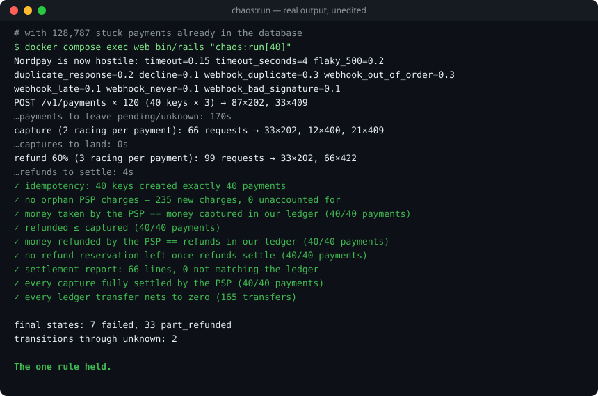
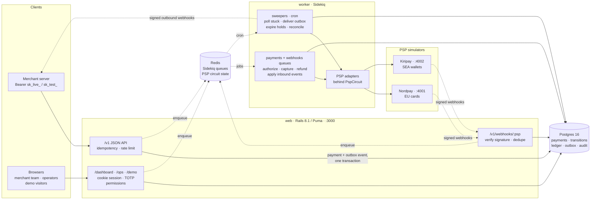
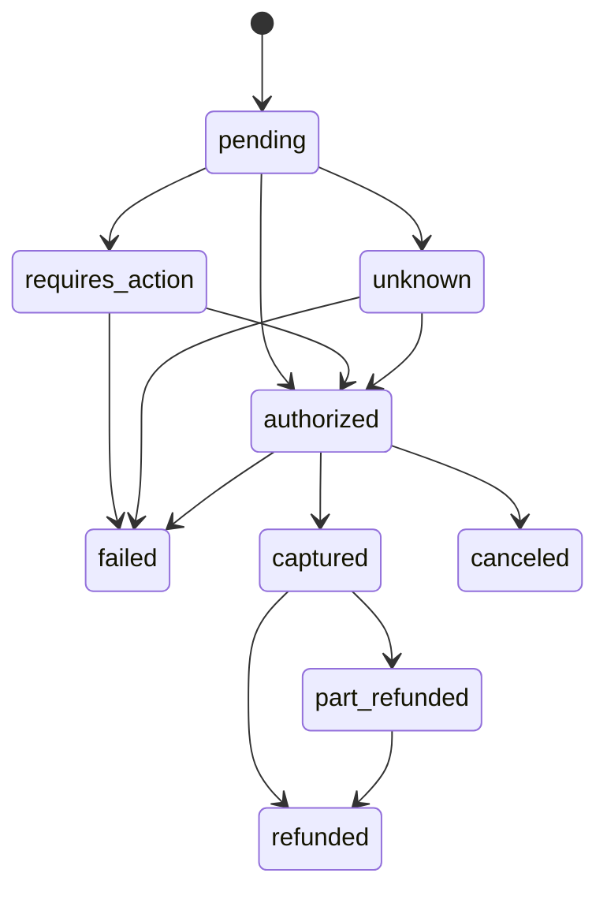
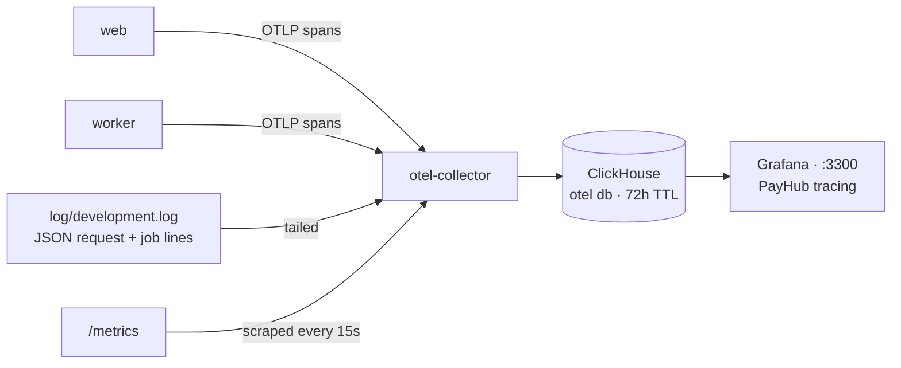

# PayHub

[](https://github.com/baobeta/payhub/actions/workflows/ci.yml)


[](LICENSE)

PayHub is a payment orchestration API. Merchants integrate once; PayHub routes each payment to one of two payment service providers (PSPs) and keeps one consistent record of every money movement.

**The one rule:** no customer is ever charged twice, and no merchant ever refunds more than they captured. This holds under timeouts, duplicate webhooks, concurrent requests, worker crashes and PSP outages.

> **Not an engineer?** Start with **[PayHub in plain words](docs/OVERVIEW.md)**: the system, a payment's journey and every design decision explained with everyday examples.

## Contents

- [Highlights](#highlights)
- [Architecture](#architecture)
- [Quick start](#quick-start)
- [Dashboards](#dashboards)
- [Local development](#local-development)
- [Configuration and troubleshooting](#configuration-and-troubleshooting)
- [API reference](#api-reference)
- [Webhook delivery guarantees](#webhook-delivery-guarantees)
- [How it works](#how-it-works)
- [Domain model and schema](#domain-model-and-schema)
- [PSP simulators](#psp-simulators)
- [Testing and verification](#testing-and-verification)
- [Observability](#observability)
- [Performance](#performance)
- [Security](#security)
- [Scope](#scope)
- [Documentation](#documentation)

## Highlights

| | |
| --- | --- |
| **Timeouts become `unknown`, not retries** | A charge the PSP might have taken is never re-sent blind. It is resolved by status poll or webhook, using a reference written *before* the call. |
| **Idempotency decided by a unique index** | Not by a `SELECT`. Three concurrent copies of one request create exactly one payment. |
| **Append-only double-entry ledger** | A trigger rejects `UPDATE` and `DELETE`. Every balance is a `SUM` over rows. |
| **Two hostile PSP simulators** | They time out, return 500s, duplicate responses, and send webhooks late, twice, out of order, badly signed or never. |
| **Proven under chaos** | [`bin/rails chaos:run`](#chaos-run) checks the ledger against the PSP's own records. A seeded deterministic simulation does the same in-process, replayably, and found two bugs the specs had missed. |
| **Settlement reconciliation** | The PSP's daily payout report is matched line by line to the ledger. Fees are booked, receivables cleared, and unexplained payouts flagged. |
| **Built to operate** | Keyset pagination proven at 1M rows, OpenTelemetry traces across HTTP → Sidekiq → PSP, Sorbet-typed adapters. |

<p align="center"></p>

## Architecture

Solid arrows are synchronous calls. Dotted arrows are asynchronous: queued jobs and webhooks.



| Component | Responsibility | Why it is separate |
| --- | --- | --- |
| **web** | Authenticates, claims the idempotency key, writes the payment and its outbox event in one transaction, enqueues the PSP call and returns `202`. Also serves the dashboards and receives PSP webhooks. | A slow PSP must never hold a Puma thread ([#8](DECISIONS.md#8-post-v1payments-returns-202-and-does-psp-work-in-sidekiq)). |
| **worker** | All PSP traffic (authorize, capture, refund, status polls, voids), outbound webhook delivery, and the scheduled sweepers and reconciliations. | Retries, backoff and crashes stay away from requests. |
| **Postgres** | The only source of truth. Unique indexes, CHECKs and append-only triggers enforce the invariants. | Correctness lives in the database, not in process memory. |
| **Redis** | Sidekiq queues, and one circuit-breaker state per PSP shared by every process ([#17](DECISIONS.md#17-a-circuit-breaker-per-psp--and-the-one-rule-any-future-failover-must-obey)). | Holds nothing that must survive. Lost jobs are re-driven from Postgres by the sweepers. |
| **nordpay / kiripay** | Deliberately unreliable PSP simulators (Sinatra), each with its own Gemfile and specs. | They stand in for real PSPs and misbehave on demand. |
| **otel-collector, ClickHouse, Grafana** | Traces, JSON logs and metrics in one place. See [Observability](#observability). | Optional; nothing is exported unless configured. |
| **vite, mailcatcher** | Development only: hot-reloaded UI bundles and a local email inbox. | Production uses precompiled assets and real SMTP. |

## Quick start

**Requirements:** Docker with Compose.

**1. Start the stack and seed it**

```bash
docker compose up --build
docker compose exec web bin/rails db:prepare db:seed
```

The seed creates a demo merchant and prints two API keys **once**: `sk_live_…` and `sk_test_…`. A test key acts on the merchant's test-mode twin, so its payments never appear under the live key ([#22](DECISIONS.md#22-test-mode-is-a-twin-merchant)).

| Service | URL |
| --- | --- |
| API and dashboards | <http://localhost:3000> |
| MailCatcher (emails) | <http://localhost:1080> |
| Grafana | <http://localhost:3300> |
| Nordpay simulator | <http://localhost:4001> |
| Kiripay simulator | <http://localhost:4002> |

**2. Create a payment**

```bash
export KEY=sk_live_…   # the key the seed printed

curl -s -X POST localhost:3000/v1/payments \
  -H "Authorization: Bearer $KEY" \
  -H "Idempotency-Key: $(uuidgen)" \
  -H 'Content-Type: application/json' \
  -d '{"amount_minor":2500,"currency":"EUR","payment_method_token":"tok_visa"}'
# → 202 {"state":"pending", …}   The PSP call happens in the worker.
```

**3. Read it back**

```bash
curl -s localhost:3000/v1/payments/<id> -H "Authorization: Bearer $KEY"
# → {"state":"authorized", "transitions":[…]}
```

About one time in ten the simulator times out, and the history reads `pending → unknown → authorized`. That is the system working as designed (see [How it works](#how-it-works)).

**Kiripay (Southeast Asian wallets).** A THB, VND or IDR payment stops at `requires_action` with a redirect URL. Simulate the customer approving it:

```bash
curl -X POST localhost:4002/_sim/charges/<kp_id>/approve
```

The simulator then sends signed webhooks, and the payment becomes `captured`.

## Dashboards

Three Vue applications are served by the same Rails app ([#21](DECISIONS.md#21-a-ui-kept-beside-the-api-rather-than-in-it)). Every sign-in requires a password and an authenticator code, and money or secret actions ask for a fresh code ([#25](DECISIONS.md#25-merchant-sign-in-database-sessions-mandatory-totp-step-up-for-sensitive-actions)).

| Dashboard | URL | For |
| --- | --- | --- |
| Merchant | <http://localhost:3000/dashboard> | A merchant's team: payments, refunds, balance, API keys, webhooks |
| Operator console | <http://localhost:3000/ops> | PayHub staff: stuck payments, approvals, reconciliation |
| Demo | <http://localhost:3000/demo> | Public visitors: scripted payments and a live chaos run |

### Merchant dashboard

The seed invites `owner@demo.payhub.local` as the demo merchant's owner and prints the invitation link (the email is also in MailCatcher). Open it, set a password, scan the QR code with an authenticator app and save the recovery codes. The owner then invites the team.

| Role | Permissions |
| --- | --- |
| owner | Everything, including transferring ownership |
| admin | Everything except transferring ownership |
| developer | API keys, webhooks and events; reads payments; cannot move money |
| support | Reads payments; capture, cancel and refund; no secrets or balances |
| viewer | Reads payments, balance and settlements; exports CSV; changes nothing |

The full permission matrix is generated in [docs/permissions.md](docs/permissions.md). The header switches between live and test data.

### Operator console

Operators have separate accounts and a separate session cookie. Create the first one from the console; the invitation link is printed and emailed:

```bash
docker compose exec web bin/rails "operators:invite[you@example.com,admin]"
```

Invite the rest from **Operators** in the UI.

| Role | Permissions |
| --- | --- |
| support | Reads the queue, payments, circuits and reconciliation; polls a PSP; redelivers events; starts a read-only "view as merchant" session |
| ops | Everything support can do, plus reviews settlement breaks and raises proposals (manual transitions, ledger corrections) |
| approver | Reads everything; approves or rejects *another* operator's proposals, and nothing else |
| admin | Reads everything; invites operators, changes roles, disables accounts, exports the access review; cannot decide proposals |

- **Money changes need two people.** A payment leaves `unknown` by hand only through a proposal approved by a different operator ([#23](DECISIONS.md#23-operators-change-money-only-with-two-people)).
- **"View as merchant" is read-only.** It shows a red banner on every screen and ends after 30 minutes.

## Local development

To run Rails on the host with the databases and simulators in Docker:

```bash
docker compose up -d db redis nordpay kiripay mailcatcher
npm install
bin/rails db:prepare db:seed
```

Then run each of these in its own terminal:

| Command | Purpose |
| --- | --- |
| `bin/rails s` | Web server |
| `bin/vite dev` | UI bundles with hot reload |
| `bundle exec sidekiq -C config/sidekiq.yml` | Background worker |
| `bin/check` | The full gate, exactly as CI runs it: zeitwerk → generated files → rubocop → sorbet → frontend → rspec → brakeman |
| `npm run e2e` | Playwright end-to-end tests (uses its own database, `payhub_e2e`) |

**Versions:** Ruby 3.3.12 (`.ruby-version`), Rails 8.1, Postgres 16, Node 22. Postgres is exposed on host port **5434**, because 5432 is often taken. The simulators are standalone apps with their own specs: `cd simulators/nordpay && bundle exec rspec`.

## Configuration and troubleshooting

**Production** also requires:

| Variable | Purpose |
| --- | --- |
| `APP_HOST` | Host used for links in emails. Boot fails without it. |
| `AR_ENCRYPTION_*` (three keys) | Active Record encryption for TOTP secrets. Generate with `bin/rails db:encryption:init`. |
| `NORDPAY_URL`, `NORDPAY_API_KEY`, `NORDPAY_WEBHOOK_SECRET` | Nordpay endpoint, API key and inbound webhook secret. During a rotation, set `NORDPAY_WEBHOOK_SECRETS=<new>,<old>` instead of the single secret. Without them, or with a simulator default such as `np_test_key`, every Nordpay call and webhook raises `PspEnv::Missing` instead of using the simulator. |
| `KIRIPAY_URL`, `KIRIPAY_API_KEY`, `KIRIPAY_WEBHOOK_SECRET` | The same for Kiripay (`KIRIPAY_WEBHOOK_SECRETS` while rotating; simulator defaults such as `kp_test_key` are refused). |
| `METRICS_TOKEN` | Bearer token for `GET /metrics` (generate with `openssl rand -hex 32`); scrapers send `Authorization: Bearer <token>`. Without it, production answers every scrape with `401`; the app still boots and logs a warning. Outside production an unset token leaves `/metrics` open. |
| `WORKER_METRICS_PORT` / `WORKER_METRICS_HOST` | Where the Sidekiq process serves its own `/metrics` (default `9394` on `0.0.0.0`), guarded by `METRICS_TOKEN` like the web endpoint. In production, keep `:9394` off public interfaces or rely on `METRICS_TOKEN`. If the port is taken, Sidekiq logs an error and runs on without it. |
| `PROMETHEUS_MULTIPROC_DIR` | Required when a service runs more than one process (Puma workers, several Sidekiq processes). Without it each process keeps its own metrics and a scrape sees only the one that answers. Use a directory per service, and wipe it when the service starts, or it keeps the stopped processes' values. Production logs a warning at boot when `WEB_CONCURRENCY` is set without it. See [RUNBOOK](RUNBOOK.md#metrics-across-processes-planned-work-at-deploy). |
| `OTEL_EXPORTER_OTLP_ENDPOINT` | Optional. Enables trace export outside Docker Compose. |
| `DEMO_ENABLED` | Optional. The public demo (`/demo`, no login) is off in production and answers `404`. Set `true` only on a demo-only host. That host still runs in production, so it needs non-default PSP keys and webhook secrets, set to the same values on PayHub and on the simulators. Other environments default to on; `false` turns it off. Only the exact value `true` enables it. |

**Common issues:**

| Problem | Fix |
| --- | --- |
| Port 3000 is taken | Put `WEB_PORT=3100` in `.env` (git-ignored). Links the app prints and emails follow it. |
| `package.json` changed but containers use old packages | Run `docker compose up -d --build -V`. The `-V` flag renews the volume that holds `node_modules`. |
| Kiripay webhooks don't arrive when Rails runs outside Compose | Set `PAYHUB_WEBHOOK_URL=http://host.docker.internal:3000/v1/webhooks/kiripay` on the simulator. |
| Puma says "a server is already running" | Run `rm tmp/pids/server.pid`. Compose does this automatically. |
| Checking that email works | Run `docker compose exec web bin/rails "mail:smoke[me@example.com]"`. |

## API reference

All requests authenticate with `Authorization: Bearer <api key>`. Every `POST` requires an `Idempotency-Key` header.

| Method | Path | Description |
| --- | --- | --- |
| `POST` | `/v1/payments` | Create a payment. Returns `202 pending`. Body: `amount_minor`, `currency`, `payment_method_token`, `capture`, `metadata` |
| `GET` | `/v1/payments/:id` | State and full transition history |
| `GET` | `/v1/payments` | List with cursor pagination. Filters: `state`, `currency`, `created_after`, `created_before` |
| `POST` | `/v1/payments/:id/capture` | Capture, in full or in part. Body: `amount_minor` (default: all still capturable), `final` (default `true`; `false` keeps the rest capturable, cards only). `amount_minor: 0, final: true` closes capturing and returns `200`. Otherwise `202`. Errors: `capture_closed`, `multicapture_unsupported`, `capture_limit_reached` (50 non-final), `capture_in_progress` ([#20](DECISIONS.md#20-a-capture-is-a-row-and-the-job-reads-the-psp-before-it-writes)) |
| `POST` | `/v1/payments/:id/cancel` | Cancel an `authorized` payment. Synchronous. `400 cancel_unsupported` on a PSP that cannot void; `409 psp_rejected` when the PSP refuses |
| `POST` | `/v1/payments/:id/refunds` | Refund, in part and repeatedly, up to the captured amount. Returns `202` |
| `GET` | `/v1/balance` | Balance per currency, computed from the ledger |
| `GET` | `/v1/events` | Outbound events and their delivery attempts, with a cursor |
| `POST` | `/v1/events/:id/redeliver` | Replay a dead-lettered event |
| `POST` | `/v1/webhooks/:psp_name` | Inbound PSP webhooks, signature-verified |
| `GET` | `/healthz` · `/metrics` | Liveness · Prometheus metrics |

**Errors.** Every non-2xx response has one shape:

```json
{"error": {"type": "…", "code": "…", "message": "…", "param": "…", "retriable": false, "request_id": "…"}}
```

A `422` lists **every** failing field under `details`.

**Idempotency.**

| Situation | Response |
| --- | --- |
| Same key, same body | The original status and body, plus `Idempotent-Replayed: true` |
| Same key, different body | `422 idempotency_error` |
| Same key, first request still running | `409`, retriable |

**Rate limits.** Counted per merchant across all of its API keys, with separate budgets: 300 requests per minute live, 75 test (Stripe's 4:1 live-to-sandbox ratio). Adding keys does not add throughput. A request whose key matches no active key is counted per IP at 30 per minute. The dashboard and ops APIs allow 300 requests per minute per signed-in session. Over a limit, the API returns `429` with `Retry-After` and `PayHub-Rate-Limited-Reason: global-rate`. Override with `RATE_LIMIT_PER_MINUTE` and `RATE_LIMIT_TEST_PER_MINUTE`.

## Webhook delivery guarantees

PayHub posts an event to the merchant's webhook URL for every payment, capture and refund change ([#4](DECISIONS.md#4-webhook-order-is-the-psps-timestamp-not-arrival-order), corollary):

```json
{"id": "…", "type": "payment.captured", "livemode": true, "created_at": "…", "sequence": 3, "attempt": 1, "data": {…}}
```

- **At least once.** The event is written in the same transaction as the change, so none is lost, but one can arrive twice. Dedupe on `id` (also sent as `X-Payhub-Event-Id`).
- **No ordering.** A retried event can arrive after a newer one. `sequence` counts each payment's events from 1 and only goes up: ignore an event whose `sequence` is lower than the last one you applied for that payment.
- **Retries.** Any answer other than 2xx, or no answer, is retried after 1m, 5m, 30m, 2h, 8h, 24h and 36h. After the 8th attempt, about 70.6 hours after the first, the event is dead. It stays listed in `GET /v1/events` with every attempt, and `POST /v1/events/:id/redeliver` gives it 8 more attempts on the same schedule.
- **Respond fast.** Return 2xx as soon as the event is stored and do the work afterwards. PayHub waits 2 seconds to connect and 5 seconds for the response; anything slower counts as a failure and is retried.
- **Signature.** `X-Payhub-Signature: t=<unix time>,v1=<hex HMAC-SHA256 of "<t>.<raw body>">`. Compare with a constant-time check and reject a `t` more than 5 minutes from now, which stops a captured delivery being replayed.
- **Secret rotation.** For 24 hours after a rotation every delivery carries two `v1=` values, one per secret, so you can deploy the new secret at any point in that window ([#15](DECISIONS.md#15-every-webhook-verifier-takes-a-list-of-secrets)).

## How it works

The domain in ten lines:

1. A **payment** is a row whose `state` caches its latest **transition**. Transitions are append-only, ordered by the PSP's own timestamp (`sort_key`), and exactly one is `most_recent` (partial unique index).
2. `psp_reference` is generated by us and written **before** the PSP is called, so a timed-out charge can always be looked up.
3. A PSP timeout moves the payment to **`unknown`**. The only exits are a status poll or a webhook; nothing re-sends a charge it can't prove was lost.
4. Every `POST` carries an **Idempotency-Key**. The claim is an `INSERT` into a unique index, and the index decides who wins.
5. Money is integer **minor units** next to an ISO-4217 code. `Currency` is the only place that knows VND has no minor unit. The FX rate is copied onto the payment at creation, never joined.
6. The **ledger** is append-only double-entry. Every movement is legs that sum to zero, a trigger rejects `UPDATE` and `DELETE`, and every balance and total is a `SUM`.
7. **Refunds** take `FOR UPDATE` on the payment and check `captured − refunded − reserved`, all three ledger sums. A refund request reserves funds; the PSP's answer posts or voids the reservation.
8. **Adapters** (`Nordpay`, `Kiripay`) satisfy one Sorbet-checked contract and declare their capabilities. The domain never branches on a PSP's name.
9. Inbound **webhooks** are verified with `secure_compare`, deduplicated by the PSP's event id, and applied by PSP timestamp, so out-of-order delivery cannot move a payment backwards.
10. Outbound events use a **transactional outbox** written with the state change. A sweeper delivers them with backoff; another polls stuck payments and pages after 15 minutes.

**A timeout, as it actually ran** against the Nordpay simulator with `timeout_rate: 1`. The simulator records the charge then hangs for 5s; our client gives up at 3s:

```
pending  -> unknown     worker   psp_ts=10.346  {"error":"Net::ReadTimeout","gave_up_at":"…13.351Z"}
unknown  -> authorized  worker   psp_ts=10.347  applied=true
```

`unknown` is dated from when we **sent** the request, not when we gave up. Otherwise the PSP's genuine timestamp looks older than ours and the poll result is discarded as stale. This exact run found that bug ([#11](DECISIONS.md#11-unknown-is-dated-from-the-moment-we-sent-the-request-not-when-we-gave-up)).

Every decision, the alternatives rejected and the trade-off accepted are recorded in **[DECISIONS.md](DECISIONS.md)**.

## Domain model and schema

The payment state machine:



The code adds one edge the diagram omits on purpose: `pending → failed`, for a synchronous decline ([#10](DECISIONS.md#10-the-state-machine-is-the-spec-diagram-plus-exactly-one-edge)). A spec parses this diagram and fails CI if code and diagram drift.

| Reference | Contents |
| --- | --- |
| [docs/DOMAIN.md](docs/DOMAIN.md) | Every table in plain words, with examples, and the rows written at each step of one payment |
| [docs/schema.dbml](docs/schema.dbml) | The full schema with constraints; paste it into [dbdiagram.io](https://dbdiagram.io) |
| `db/structure.sql` | The source of truth |

## PSP simulators

Two deliberately unreliable simulators stand in for real PSPs:

- **Nordpay** (`:4001`) handles EU cards. It authorizes and captures separately, and supports partial refunds.
- **Kiripay** (`:4002`) handles Southeast Asian wallets. It is capture-only, reports results by webhook only, and has no idempotency.

They time out, return errors, and send webhooks late, twice, out of order or never. Any of this can be forced per request with the `X-Sim-Force` header.

Behaviour, signatures, failure modes and admin endpoints are documented in **[docs/SIMULATORS.md](docs/SIMULATORS.md)**.

## Testing and verification

`bin/check` runs the whole gate, and CI runs exactly the same thing.

| Layer | What it proves |
| --- | --- |
| **Request specs** | Every endpoint, including the unhappy paths |
| **Idempotent jobs** | Job specs call `perform` twice and assert the ledger is unchanged |
| **Real-thread concurrency** | With real connections and no transactional fixture: N identical idempotency keys produce one payment; N simultaneous refunds on one capture allow one; three outbox sweepers never double-send |
| **Deterministic simulation** | `spec/simulation` ([#19](DECISIONS.md#19-a-seeded-deterministic-simulation-holds-the-whole-system-to-the-psps-truth)): one seed drives PSP faults, job order and duplication, webhook loss and reordering, merchant actions and a virtual clock. Invariants are checked after every step, and the books must equal the PSP's truth at the end. A failure prints its seed and replays exactly |
| **Property test** | 25 random capture and refund sequences: the ledger balances, `refunded ≤ captured ≤ authorized`, and balance = captured − refunded |
| **State-machine spec** | Parses the diagram in this README and fails if code and diagram drift |
| **No card data in logs** | Captures everything Rails logs during a request carrying a card number |

The simulation's first runs found two real bugs that every other spec had passed: a payment stranded in `unknown` ([#11](DECISIONS.md#11-unknown-is-dated-from-the-moment-we-sent-the-request-not-when-we-gave-up)) and a partial capture charged twice ([#20](DECISIONS.md#20-a-capture-is-a-row-and-the-job-reads-the-psp-before-it-writes)).

### Chaos run

The specs prove each guard in isolation. The chaos run proves them together, over real HTTP:

```bash
docker compose exec web bin/rails chaos:run         # 40 payments
docker compose exec web bin/rails "chaos:run[200]"  # or more
```

It sets Nordpay to: 15% timeouts, 20% flaky 500s, 20% duplicated response bodies, 30% duplicated and out-of-order webhooks, and 10% never-sent or badly signed webhooks.

Then it:
1. sends every payment **three times at once** with the same `Idempotency-Key`,
2. races **two full captures** on each authorized payment,
3. races **three 60% refunds** on each captured payment (at most one fits).

When the sweepers have settled everything, it checks against the **simulator's own records**:
- N keys produced exactly N payments, and the PSP holds no charge that isn't ours.
- For every payment, money captured and refunded at the PSP equals our ledger, refunded ≤ captured, and no reservation is left over.
- Every ledger transfer nets to zero.
- Every line of the day's settlement report matches the ledger, and every capture was paid out in full.

It exits non-zero on any violation and restores the simulator's configuration afterwards.

## Observability

| Signal | Details |
| --- | --- |
| **Logs** | One JSON line per request (lograge) and per job, carrying `request_id`, `merchant_id`, `payment_id`, `psp_name` and `duration_ms`. Jobs inherit the enqueuing request's id, so `grep '"payment_id":"…"' log/*.log` reconstructs a payment's whole life. Request bodies are never logged. Every PSP call also writes one redacted `psp_call` line (PSP, method, path template, status, outcome, duration, reference, error), which survives when the transaction holding its `psp_calls` row rolls back. |
| **Metrics** | `GET /metrics` (Prometheus): `payhub_payments_created_total`, `payhub_psp_calls_total`, `payhub_webhook_deliveries_total`, `payhub_webhook_duplicates_total`, `payhub_webhook_signature_failures_total`, `payhub_stuck_payment_alerts_total`, `payhub_ledger_imbalance_detected_total`, `payhub_psp_call_in_transaction_total` (a PSP call made inside a database transaction, which [#13](DECISIONS.md#13-the-sweeper-schedules-each-payment-instead-of-re-scanning-the-oldest) forbids; should stay 0); gauges `payhub_unknown_state_payments`, `payhub_outbound_events_pending`, `payhub_outbound_events_dead`. Requires a bearer token; see `METRICS_TOKEN`. Metrics are per service: with `PROMETHEUS_MULTIPROC_DIR` set, every process of that service writes to files there, and its scrape sums counters and reports each gauge's most recently set value. Docker Compose sets one directory each for web and worker. The web scrape does not include counters raised in Sidekiq jobs (`payhub_late_success_total`, `payhub_stuck_payment_alerts_total`, …): the worker serves those on its own `GET :9394/metrics` (`WORKER_METRICS_PORT`, bound on `WORKER_METRICS_HOST`, default `0.0.0.0`), with the same token rule. It does not refresh the DB-backed gauges on scrape; the sweepers set them. |
| **Traces** | OpenTelemetry across web, Sidekiq and every PSP call, with each SQL statement as a span |
| **Alert** | `event=alert.stuck_payment` at ERROR, for any payment in `pending` or `unknown` past 15 minutes. This is the only signal that pages; everything else is a dashboard. |
| **Health** | `GET /healthz` checks the database only. A liveness probe that fails on a slow dependency causes restarts, not fixes. |

Docker Compose also runs a telemetry stack ([observability/](observability/)):



The collector's scrape sends no token yet, so it relies on `METRICS_TOKEN` being unset in development, which leaves `/metrics` open there.

In Grafana (<http://localhost:3300>, no login locally), the *PayHub tracing* dashboard lets you filter by `payment_id`. Clicking a `trace_id` shows its waterfall with that trace's log lines underneath.

- **Ad-hoc SQL:** `curl 'localhost:8123/?user=otel&password=otel' -d 'SELECT SpanName, count() FROM otel.otel_traces GROUP BY 1'`
- **"Error spans" include handled exceptions.** For example, a duplicate webhook is rejected by a unique index on purpose, and that still counts.

## Performance

`GET /v1/payments` uses keyset pagination and stays under a millisecond at one million rows: **p50 0.69 ms, p95 1.21 ms**. To reproduce with `bin/rails perf:seed[1000000]`, `perf:explain` and `perf:bench`, and to see the query plan, read **[docs/PERFORMANCE.md](docs/PERFORMANCE.md)**.

## Security

- **No card numbers.** `payment_method_token` is opaque. In production, a PCI-scoped tokenization service (or the PSP's hosted fields) receives the card number directly from the customer's browser, which keeps PayHub at SAQ-A scope.
- **Redaction.** As defence in depth, `filter_parameters` redacts `card`, `cvv`, `number`, `token`, `authorization`, `signature` and every opaque blob column. `spec/requests/v1/pan_never_logged_spec.rb` proves a card number in any field never reaches the log. That test found two real leaks during development.
- **Access control.** Permissions are a catalogue in code, checked on every action and verified in CI ([#24](DECISIONS.md#24-permissions-are-a-catalogue-in-code-checked-per-action-verified-in-ci)). Sessions are server-side and revocable, with mandatory TOTP and step-up for sensitive actions ([#25](DECISIONS.md#25-merchant-sign-in-database-sessions-mandatory-totp-step-up-for-sensitive-actions)).
- **Tamper-evident records.** The ledger, audit log and PSP call log are append-only, enforced by database triggers.

## Scope

Deliberately out of scope:

- **The `/v1` API stays JSON-only.** The dashboards are separate bundles beside it, and nothing they add is reachable through `/v1`.
- **No real PSP credentials or card numbers.**
- **No chargebacks or disputes.**
- **No bank-statement matching.** Settlement reports are reconciled against the ledger ([#18](DECISIONS.md#18-reconcile-against-what-the-psp-paid-not-only-what-its-api-says)); bank deposits are not.
- **No Kubernetes.** `docker compose up` is the deployment. Production `Dockerfile` hardening (multi-stage, non-root, precompiled bootsnap) is noted, not done.

## Documentation

| Document | Audience | Contents |
| --- | --- | --- |
| [docs/OVERVIEW.md](docs/OVERVIEW.md) | Everyone | PayHub in plain words: the system, a payment's journey, every decision with everyday examples |
| [docs/DOMAIN.md](docs/DOMAIN.md) | Everyone | The domain model in plain words: every table, with examples |
| [DECISIONS.md](DECISIONS.md) | Engineers | 26 design decisions: what was chosen, what was rejected, why, and the trade-off accepted |
| [RUNBOOK.md](RUNBOOK.md) | On-call | What to do when an alert fires |
| [docs/permissions.md](docs/permissions.md) | Engineers, security | Generated permission matrix |
| [docs/schema.dbml](docs/schema.dbml) | Engineers | Full database schema |
| [docs/SIMULATORS.md](docs/SIMULATORS.md) | Engineers | PSP simulator behaviour, failure modes and admin endpoints |
| [docs/PERFORMANCE.md](docs/PERFORMANCE.md) | Engineers | Pagination at 1M rows: how to reproduce, query plan, timings |
| [docs/ASSIGNMENT.md](docs/ASSIGNMENT.md) | Reviewers | The original brief this repository answers |
