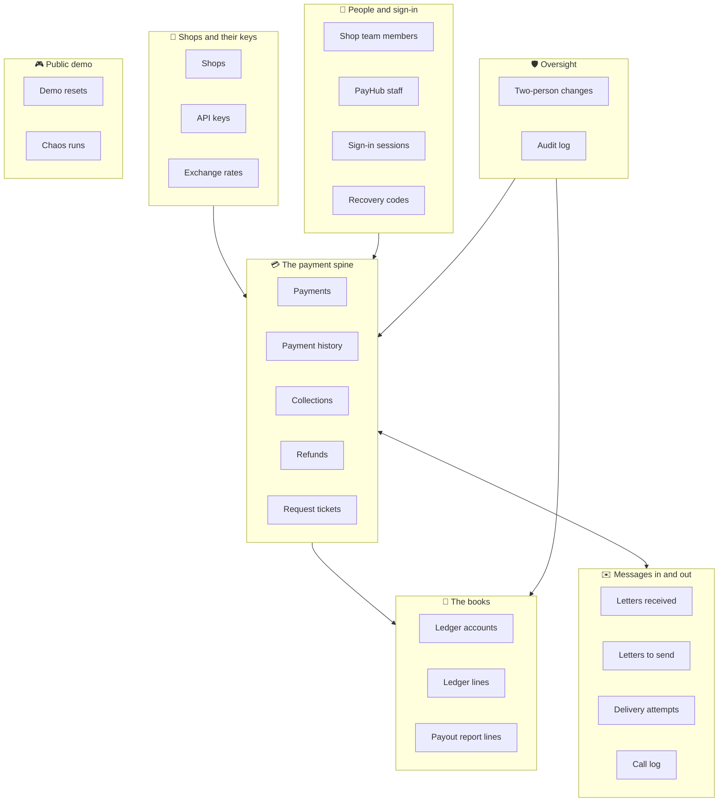
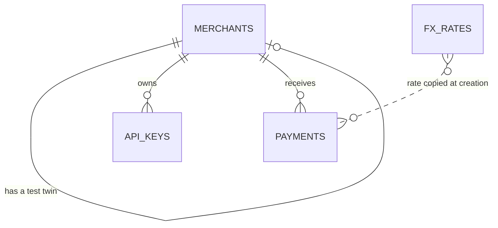
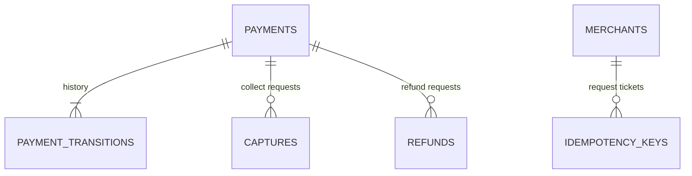
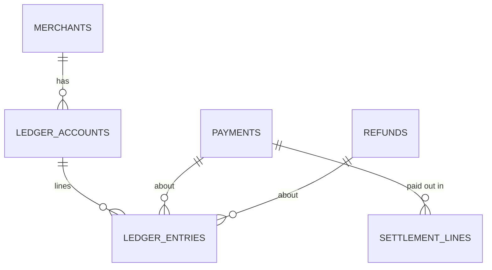
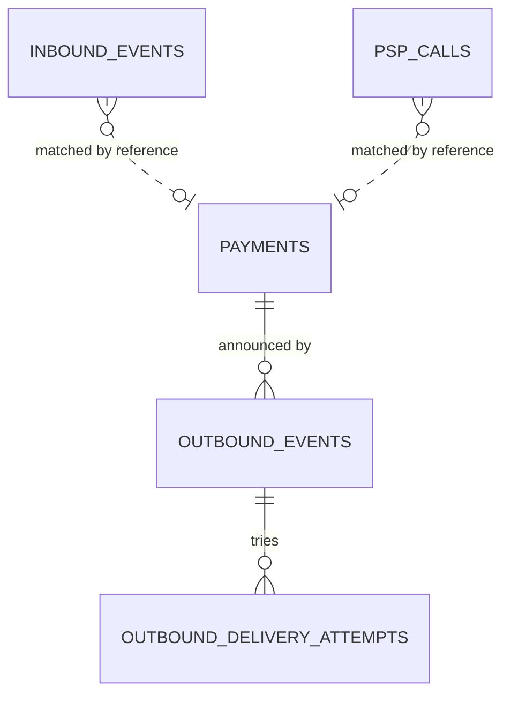
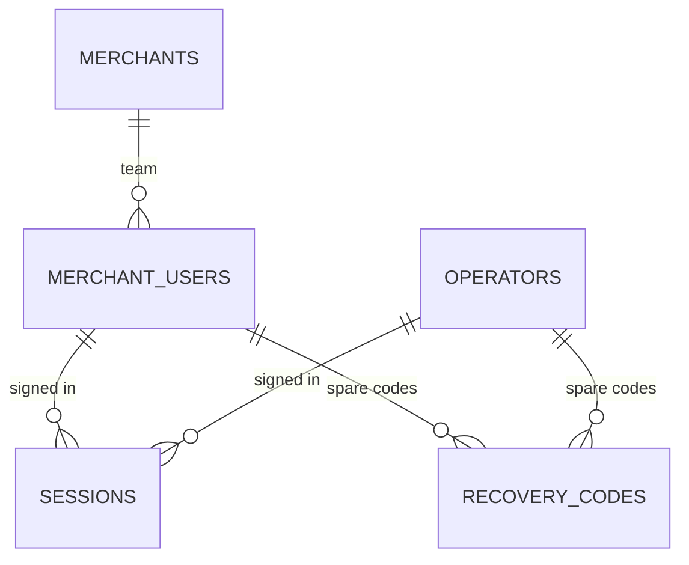
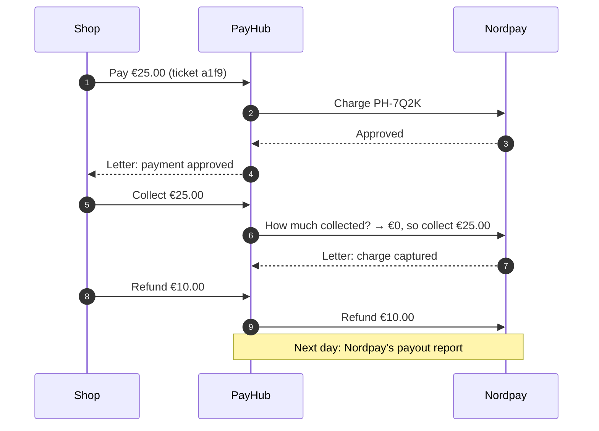

# PayHub's domain model, in plain words

> Written for readers without a technical background. Engineers: the exact columns, indexes and constraints are in [schema.dbml](schema.dbml) (paste it into dbdiagram.io) and `db/structure.sql`.

## What is a domain model?

A domain model is the list of **things a system keeps track of**, and how those things relate to each other. For a library, the things would be books, members and loans. For PayHub, they are shops, payments, refunds, the account book, messages and the people who use the dashboards.

Each thing is stored as a **table**, like a spreadsheet tab, and each **row** in it is one example of that thing: one shop, one payment, one refund. PayHub has 23 tables. They fall into seven groups:

The **payment spine** is the centre. Almost every other table records something that happened *to* a payment, or something needed to keep payments safe.

### Four rules that apply everywhere

| Rule | What it means | Why |
| --- | --- | --- |
| Money is whole numbers of the smallest unit | €25.00 is stored as `2500` cents, next to the currency `EUR`. Vietnamese đồng has no smaller unit, so ₫50,000 is `50000` | Decimals can round wrongly. Whole numbers can't. |
| Some tables are written in pen | The ledger, the call log, the audit log and payment history can only be added to. The database refuses edits and deletes | History you can rewrite isn't evidence |
| Statuses are words, not numbers | A payment's status is stored as `authorized`, not `3` | Someone reading the data at 3am can understand it |
| IDs sort by time | Every row's ID starts with the moment it was created | Lists stay fast even at a million payments |

---

## 🏪 Shops and their keys

### Shops · `merchants`
**What it is:** a business that takes payments through PayHub.
**Everyday version:** a customer account at a bank.
**Example:** *Demo Shop*, prices in EUR, sends its notifications to `https://demo.shop/payhub-hook`.
**Rules that protect it:**
- Every live shop can have one **test twin**, a second shop record used for trying things without real money. A test twin always points at its live shop, and a live shop never points at anything.
- The shop's secret for signing notifications can be changed. The old one keeps working for 24 hours afterwards.

### API keys · `api_keys`
**What it is:** the passwords a shop's software uses to talk to PayHub. A shop can have several.
**Everyday version:** keys to the shop's back door, cut separately for each person who needs one.
**Example:** "Checkout server", `sk_live_…a91c`, last used 2 minutes ago.
**Rules that protect it:**
- PayHub stores only a fingerprint of the key. The real key is shown **once**, when it's created.
- `sk_live_` keys open the live shop and `sk_test_` keys open the test twin. The prefix and the mode must match.
- When a key is replaced, the old one keeps working until a set time. When a key is revoked, it stops working at once. Keys are never deleted.

### Exchange rates · `fx_rates`
**What it is:** currency conversion rates, such as EUR → USD = 1.08.
**Everyday version:** the rates board at a currency exchange counter.
**Rules that protect it:** the rate is **copied onto each payment when it's created**, so a payment's value in the shop's own currency never changes later because rates moved.

---

## 💳 The payment spine

### Payments · `payments`
**What it is:** one customer paying one shop.
**Everyday version:** an order slip.
**Example:** €25.00 from Anna to Demo Shop, sent to Nordpay with our reference `PH-7Q2K`, status *Approved*.
**What it holds:** the amount and currency; which card company handles it (chosen by currency: EUR, GBP and USD go to Nordpay, VND, THB and IDR to Kiripay); **our reference number, saved before we call the card company**; the current status; when collecting was closed (after the last collection); a card *token* (never the card number itself); and the night watch's notes (when we first sent it, when to check it next, how many checks so far).
**Rules that protect it:**
- The status is always one of the stops in the [payment's journey](OVERVIEW.md#a-payments-journey).
- The same card company can't produce two payments for the same reference.
- The status here is a convenient copy. The real history is in the next table.

### Payment history · `payment_transitions`
**What it is:** one row for every time a payment changes status.
**Everyday version:** a parcel's tracking history. *"Waiting → Not sure yet → Approved → Collected"*, with who caused each step.
**Example:** *Not sure yet → Approved*, caused by the night watch, timed by Nordpay at 10:00:10.347.
**Rules that protect it:**
- Steps are ordered by the **card company's** timestamp, not by when the message reached us, so a late message can't move a payment backwards.
- Exactly one step per payment is marked "current", and the database enforces it.
- An outdated message is still recorded (useful evidence) but changes nothing.
- It's written in pen: rows are only ever added.

### Collections · `captures`
**What it is:** one request from the shop to take held money, in full or in part.
**Everyday version:** a till receipt for "take €10 of the €25 deposit now".
**Example:** €10.00 on PH-7Q2K, *not the last one*. When requested, €0.00 had been collected. Status *succeeded*. €15.00 can still be collected.
**Rules that protect it:**
- A shop may collect in several parts, like a hotel taking the deposit in stages. Each collection is the **last one** unless the shop says otherwise. After the last one, nothing more can be collected. A collection of €0.00 marked "last" just closes collecting.
- What isn't collected is not handed back to the customer's bank by PayHub: the bank lets the hold lapse. If a partly collected payment sits untouched for 6 days, PayHub closes collecting itself.
- Collections can never add up to more than was approved, and at most 50 can be "not the last one". Wallets (Kiripay) collect everything at once.
- Refunds may come between collections. A payment counts as fully refunded only once collecting is closed and everything collected was given back.
- Only **one** collection per payment can be in progress at a time. A second request is asked to retry.
- Each collection remembers how much had been collected *before* it. Before sending, PayHub asks the card company for its total, so it can tell whether this collection already happened. This is what stops a customer being charged twice.

### Refunds · `refunds`
**What it is:** one request to give money back.
**Everyday version:** a returns slip.
**Example:** €10.00 back to Anna on PH-7Q2K, reason "item damaged", status *succeeded*.
**Rules that protect it:**
- Refunds can never add up to more than was collected. This rule spans several rows, so it's checked with the payment locked, using the **ledger's** numbers, not this table's.
- Each refund gets its own reference number, saved before the card company is called (the same rule as payments).

### Request tickets · `idempotency_keys`
**What it is:** the one-time number a shop sends with every request, plus the answer PayHub gave.
**Everyday version:** a coat check stub. Show the same stub again and you get the same coat back.
**Example:** ticket `a1f9…` from Demo Shop, answered "202, payment created", kept for 24 hours.
**Rules that protect it:**
- Only one row per shop and ticket. The database decides who wins when copies arrive at the same instant.
- Reusing a ticket with a *different* request is refused.
- While the first request is still running, a copy is told to retry shortly.

---

## 📒 The books

### Ledger accounts · `ledger_accounts`
**What it is:** a page in the account book, one per shop, per currency, per kind of money.
**Everyday version:** the labelled jars on a kitchen shelf.

| Kind | Plain meaning |
| --- | --- |
| `psp_receivable` | Money the card company owes us but hasn't paid out yet |
| `merchant_payable` | Money we owe the shop |
| `refunds_reserved` | Refund money set aside while we wait for the card company's answer |
| `refunds_paid` | Refunds the card company has confirmed |
| `psp_payouts` | Money the card company actually paid out, according to its daily report |
| `psp_fees` | The card company's fees, according to its daily report |

**Rules that protect it:** there is no "balance" column. A balance is always **the sum of the lines** on that page.

### Ledger lines · `ledger_entries`
**What it is:** one line in the account book.
**Everyday version:** a line in a bank passbook, written in pen.
**Example:** a €25.00 collection is two lines. "Card company owes us" goes **up** €25.00 and "we owe the shop" goes up €25.00 on the other side. The pair cancels out to zero.
**Rules that protect it:**
- Lines come in groups (a *transfer*) that must add up to zero. If they don't, an alarm fires.
- **Written in pen:** the database refuses any edit or delete. Mistakes are fixed with new correcting lines, which a person proposes and a second person approves.
- A refund can be settled (confirmed or cancelled) only once. A second attempt is a database error.

### Payout report lines · `settlement_lines`
**What it is:** one line from the card company's daily payout report.
**Everyday version:** one line on your bank statement, ticked off against your receipts.
**Example:** PH-7Q2K, paid €24.55 plus a €0.45 fee on 21 Oct. Status *matched*.
**Status values:** *matched* (agrees with our books, so it's booked), *unmatched* (we have no record of it), *mismatch* (the amounts disagree).
**Rules that protect it:**
- Each report line is read exactly once, so re-reading a report is harmless.
- Only matched lines are booked. Anything else waits for a person to review it and add a note.

---

## ✉️ Messages in and out

### Letters received · `inbound_events`
**What it is:** every message a card company sent us on its own, such as "charge captured".
**Everyday version:** the post tray, where every letter is kept, including the junk.
**Example:** Nordpay, event `evt_831`, "charge.captured" for PH-7Q2K, signature valid, applied 10:05:02.
**Rules that protect it:**
- The card company's own message ID is unique, so the same letter sent five times is stored once and acted on once.
- A letter with a bad signature is stored, raises an alert, and is **never acted on**.
- A letter doesn't have to be linked to a payment, because it can arrive before our own record is finished. It's matched by reference number when it's processed.

### Letters to send · `outbound_events`
**What it is:** every notification PayHub owes a shop, such as "payment approved" or "refund succeeded".
**Everyday version:** the outgoing post tray.
**Example:** *payment.captured* for PH-7Q2K, delivered on the 1st attempt.
**Status values:** *pending* (waiting to go), *delivered*, *dead* (gave up after many tries; staff or the shop can resend).
**Rules that protect it:** the letter is written **at the same moment** as the status change it describes. Either both are saved or neither is, so a letter can never be lost or sent for something that didn't happen.

### Delivery attempts · `outbound_delivery_attempts`
**What it is:** one row each time PayHub tries to deliver a letter.
**Everyday version:** the courier's "we tried to deliver" notes.
**Example:** attempt 2 for *payment.captured*: the shop's server answered 503 after 1.2s, so PayHub waits longer and tries again.

### Call log · `psp_calls`
**What it is:** every request PayHub sent to a card company, with the answer (or the lack of one).
**Everyday version:** a phone bill that lists every call, how long it took, and whether anyone picked up.
**Example:** `POST /charges/:ref` to Nordpay for PH-7Q2K, **timeout** after 3,000 ms.
**Rules that protect it:** secrets and card details are removed before saving. It's written in pen: no edits, and nothing can be deleted for 12 months.

---

## 👥 People and sign-in

### Shop team members · `merchant_users`
**What it is:** a person on a shop's team who uses the dashboard.
**Example:** `support@demo.shop`, role *support*, authenticator set up, invited by the owner.
**Roles:** owner, admin, developer, support, viewer (see the [role table](../README.md#merchant-dashboard)).
**Rules that protect it:**
- Each email belongs to one person in one shop, and capital letters don't count as a difference.
- Exactly **one active owner** per shop.
- Passwords and the authenticator secret are stored scrambled or encrypted, never readable.
- Ten wrong tries lock the account for a while. An authenticator code can't be used twice.

### PayHub staff · `operators`
**What it is:** PayHub's own employees who use the operations console.
**Roles:** support, ops, approver, admin.
**Rules that protect it:** kept completely separate from shop team members, with a different sign-in cookie and different permissions. A shop can never grant staff powers.

### Sign-in sessions · `sessions`
**What it is:** one signed-in browser.
**Everyday version:** a visitor badge, logged at reception and cancellable from the front desk.
**Example:** Anna's colleague on Chrome, live mode, last active 3 minutes ago, fresh code entered 6 minutes ago.
**Rules that protect it:**
- The browser holds only a signed ticket number. Cancelling the row signs that browser out immediately.
- It records the last activity (for the 15-minute idle timeout) and the last fresh authenticator code (money and secret actions need one from the last 10 minutes).
- When a staff member views a shop's dashboard, the session records which shop, the case reference, and an end time. The view is read-only and lasts 30 minutes.

### Recovery codes · `recovery_codes`
**What it is:** ten spare one-time codes for when someone loses their phone.
**Everyday version:** the spare key you gave a neighbour.
**Rules that protect it:** each code works once, is shown once, and only its fingerprint is stored.

---

## 🛡️ Oversight

### Two-person changes · `operator_proposals`
**What it is:** a request by one staff member to change a payment's status or correct the books by hand. Another staff member must approve it.
**Everyday version:** a bank vault that needs two keys.
**Example:** Mai proposes "mark PH-9XC4 as failed. Reason: Nordpay confirmed no charge. Case OPS-4411". Tom approves it, and it's applied.
**Status values:** *pending*, *withdrawn*, *rejected*, *applied*, *failed* (approved, but the change couldn't be applied; the error is kept).
**Rules that protect it:**
- The person who approves **can't** be the person who proposed. The database itself refuses it.
- Once submitted, what is being proposed can't be edited. To change it, withdraw it and propose again.
- Clicking "submit" twice still creates only one proposal.

### Audit log · `audit_events`
**What it is:** who did what, to what, and whether it worked or was refused.
**Everyday version:** the security camera log.
**Example:** `support@demo.shop` performed *refund.created* on PH-7Q2K, result *success*, from IP 203.0.113.7.
**Rules that protect it:**
- Written in pen. Rows can't be edited, and can't be deleted until they are 12 months old.
- The person's email is copied in at the time, so the log still reads correctly after they leave.
- Request contents, passwords and session details are never stored here.

---

## 🎮 Public demo

### Demo resets · `demo_epochs`
**What it is:** a marker that says "the demo starts fresh from now".
**Why it exists:** payments and ledger lines can't be deleted. So a reset doesn't erase anything; the demo simply shows only what happened after the latest marker.

### Chaos runs · `demo_chaos_runs`
**What it is:** one press of the demo's "run the chaos test" button: up to 20 payments against a misbehaving card company, with the results.
**Rules that protect it:** only one run can be active across the whole system. A second press is asked to wait.

---

## What gets written, each time something happens

The best way to understand the model is to follow one payment. Anna pays Demo Shop €25.00 by card. The shop collects it, then refunds €10.00.

| # | What happens | Rows written |
| --- | --- | --- |
| 1 | Shop sends "pay €25.00" with ticket `a1f9` | **Request tickets** +1 (claims `a1f9`) · **Payments** +1 (*Waiting*, reference PH-7Q2K) · **Payment history** +1 (→ Waiting, caused by the API) |
| 2 | Back office charges Nordpay | **Call log** +1 (charge, OK). PayHub notes when it first sent the request. |
| 3 | Nordpay approves | **Payment history** +1 (Waiting → Approved) · **Payments** status updated · **Letters to send** +1 (*payment.authorized*) |
| 4 | Night watch delivers the letter | **Delivery attempts** +1 (200 OK) · the letter becomes *delivered* |
| 5 | Shop asks to collect €25.00 | **Request tickets** +1 · **Collections** +1 (*pending*, €0.00 collected before) |
| 6 | PayHub checks, then collects | **Call log** +2 (the "how much so far?" read, then the collect) · **Ledger lines** +2 (card company owes us €25.00 / we owe the shop €25.00) · **Collections** → *succeeded*, and collecting closes (it was the last one) · **Payment history** +1 (→ Collected) · **Letters to send** +2 (*payment.captured* and *capture.succeeded*) |
| 7 | Nordpay's letter "charge captured" arrives | **Letters received** +1. It's already applied, so the status doesn't change. If it arrives five times, it's still stored once. |
| 8 | Shop refunds €10.00 | **Refunds** +1 (*pending*) · **Ledger lines** +2 (€10.00 moved from "we owe the shop" to "set aside for refunds"), saved together |
| 9 | Nordpay confirms the refund | **Call log** +1 · **Ledger lines** +2 (€10.00 moved from "set aside" to "refunds paid") · **Refunds** → *succeeded* · **Payment history** +1 (→ Partly refunded) · **Letters to send** +2 (*payment.part_refunded* and *refund.succeeded*) |
| 10 | Next day, the payout report | **Payout report lines** +1 (*matched*) · **Ledger lines** (the receivable clears into "paid out" €24.55 and "fees" €0.45) |
| — | Throughout | **Audit log**: the dashboard refund in step 8 was recorded with the person who did it |

After all ten steps:
- Anna was charged once and refunded once.
- The shop's balance is the sum of its ledger lines: **€15.00**.
- Every group of ledger lines adds up to zero.
- Nothing was edited or deleted along the way.
