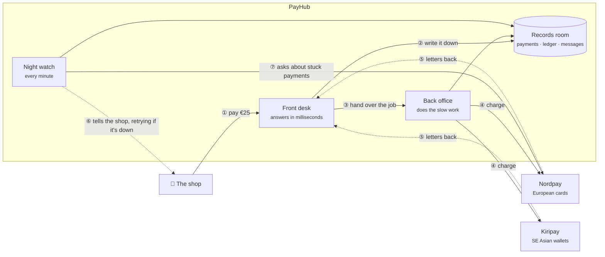
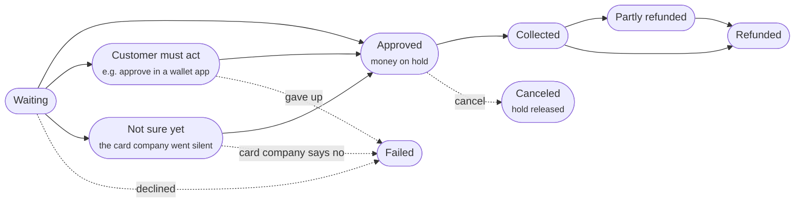
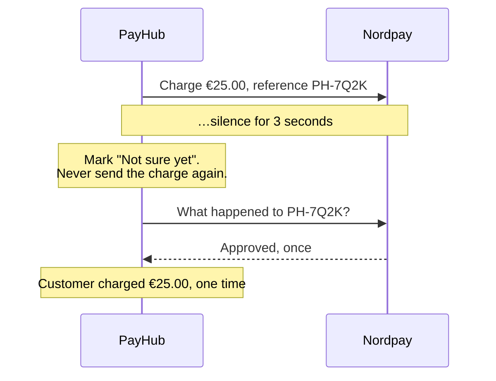
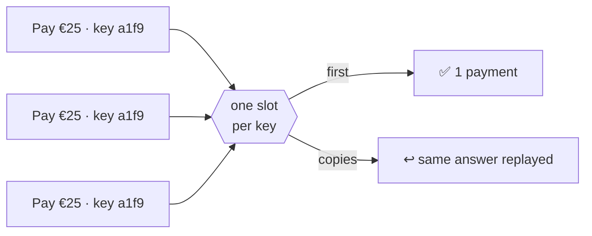
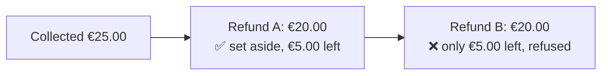

# PayHub in plain words

> For readers without a technical background: product, operations, finance, leadership and new teammates. Engineers: start with the [README](../README.md) and [DECISIONS.md](../DECISIONS.md).

PayHub sits between online shops and the companies that actually move card and wallet money. A shop connects to PayHub once, and PayHub does the rest. Those companies are unreliable on purpose here. They go silent, send the same message five times, or send messages in the wrong order. PayHub's job is to stay correct anyway.

## Words we use

| Plain word | What it means | Technical name |
| --- | --- | --- |
| Shop | The business selling something. It sends payments to PayHub. | merchant |
| Card company | The outside company that moves the money. PayHub works with Nordpay (European cards) and Kiripay (Southeast Asian wallets). | PSP, payment service provider |
| Hold | Money reserved on the customer's card but not taken yet, like a hotel deposit. | authorization |
| Collect | Actually taking the held money, usually when the order ships. | capture |
| Letter | A message a card company sends on its own: "this payment changed". | webhook |
| Ledger | PayHub's account book. Every cent that moves is written here and never erased. | double-entry ledger |
| Reference number | PayHub's own label for a payment, chosen *before* talking to the card company. | `psp_reference` |
| Night watch | Background helpers that check stuck payments and deliver messages every minute. | sweepers |

## The map

Everything inside the PayHub box is ours. Everything outside it belongs to someone else and can fail at any moment. Solid lines are calls PayHub makes. Dotted lines are messages that arrive later: sometimes late, sometimes twice, sometimes out of order.

## A payment's journey

Every payment is always at exactly one stop. A stop exists only where PayHub can honestly say it is true. For what PayHub stores along the way, see [the domain model in plain words](DOMAIN.md).

**Example: Ben pays €40.00 and Nordpay goes silent.**

| Time | What happens | Stop |
| --- | --- | --- |
| 10:00:10 | PayHub saves reference PH-9XC4, then asks Nordpay to charge | Waiting |
| 10:00:13 | No answer after 3 seconds. PayHub does **not** try again, because Nordpay may already have charged Ben | Not sure yet |
| 10:00:42 | The night watch asks Nordpay what happened to PH-9XC4. Nordpay says it was approved | Approved |
| later | The shop ships and collects €40.00 | Collected |
| **Result** | **Ben was charged once** | |

## Three ideas in pictures

**1. When we don't know, we ask instead of trying again.** Your phone call to a pizza place drops right after you order. If you order again you might get two pizzas. If you ask "did you get order 123?", you can't.

**2. Same request three times, one payment.** Like a coat check: one ticket, one coat. Each request from a shop carries a one-time number, and the records room accepts only one request per number.

**3. Money promised for a refund is set aside at once.** It works like splitting a restaurant bill. Once someone says "I'll pay €20", that €20 is spoken for. Here, €25.00 was collected and two €20.00 refunds arrive at the same moment:

## The decisions, at a glance

Each row links to the full entry in [DECISIONS.md](../DECISIONS.md), which also covers what we rejected and why.

| Question | What we decided | Everyday version | What it costs us | # |
| --- | --- | --- | --- | --- |
| The card company goes silent mid-payment? | Mark it "Not sure yet" and **ask**. Never re-send the charge | Ask the pizza place about order 123, don't order again | A payment can wait in "Not sure yet" for a minute or more, and shops must handle that state | [1](../DECISIONS.md#1-unknown-is-a-first-class-payment-state), [2](../DECISIONS.md#2-psp_reference-is-generated-and-stored-before-the-psp-call), [11](../DECISIONS.md#11-unknown-is-dated-from-the-moment-we-sent-the-request-not-when-we-gave-up) |
| The shop presses "Pay" three times? | A one-time number per request. The database lets only one in | A coat check ticket | A database write on every request, and a duplicate that arrives mid-flight must retry | [3](../DECISIONS.md#3-idempotency-is-enforced-by-a-unique-index-not-a-lookup) |
| A "collect" request is sent twice? | Ask how much was already collected **before** sending. One collection at a time | Check the tracking page before reordering a parcel | An extra call to the card company per collection, and a second collection at the same moment must retry | [20](../DECISIONS.md#20-a-capture-is-a-row-and-the-job-reads-the-psp-before-it-writes) |
| How do we know a balance is right? | Never store one. Record every movement as two lines that cancel out, in pen | A bank passbook: corrections are new lines | Balances are added up each time, which gets slower as history grows | [5](../DECISIONS.md#5-balances-are-derived-from-an-append-only-double-entry-ledger) |
| Could a shop refund more than it collected? | One refund at a time per payment, and promised refunds are set aside immediately | Splitting a restaurant bill | Refunds on one payment queue behind each other, and "available" drops before a refund succeeds | [6](../DECISIONS.md#6-over-refund-is-prevented-by-a-row-lock-plus-a-ledger-sum), [16](../DECISIONS.md#16-refund-reservations-are-two-phase-ledger-transfers) |
| Messages arrive in the wrong order? | Sort by the card company's own timestamp, not by arrival time | Sorting postcards by postmark | We trust the card company's clock | [4](../DECISIONS.md#4-webhook-order-is-the-psps-timestamp-not-arrival-order) |
| Did the card company actually pay us? | Compare its daily payout report line by line. Flag mismatches, never "fix" them | Checking your bank statement against receipts | Problems show up the next day, and Kiripay has no report to check | [18](../DECISIONS.md#18-reconcile-against-what-the-psp-paid-not-only-what-its-api-says) |
| Why answer "working on it" instead of "approved"? | The front desk replies in milliseconds. The back office talks to the card company | A restaurant gives you an order number | Shops don't get an instant yes/no and must listen for messages or check back | [8](../DECISIONS.md#8-post-v1payments-returns-202-and-does-psp-work-in-sidekiq) |
| Who checks on stuck payments? | The night watch, every minute: half the oldest, half the newest, each on its own schedule | A nurse's rounds | Payments that stay silent get checked less often over time | [7](../DECISIONS.md#7-the-sweeper-holds-no-lock-across-the-psp-call-each-write-takes-a-short-row-lock), [13](../DECISIONS.md#13-the-sweeper-schedules-each-payment-instead-of-re-scanning-the-oldest) |
| A card company goes down? | Stop calling it for 30 seconds, then try once | A fuse box | Payments wait during the pause instead of trying | [17](../DECISIONS.md#17-a-circuit-breaker-per-psp--and-the-one-rule-any-future-failover-must-obey) |
| Money on hold that nobody collects? | Release it after 6 untouched days and tell the shop | A hotel deposit, released at checkout | A shop can't hold money longer than 6 days | [14](../DECISIONS.md#14-an-authorization-nobody-captures-is-voided-after-6-idle-days) |
| Two very different card companies? | One adapter each, speaking one common language and declaring what it can do | A travel plug adapter | Every new capability needs a flag and a rule, and the shared language must fit both | [9](../DECISIONS.md#9-adapters-declare-capabilities-the-domain-enforces-rules), [12](../DECISIONS.md#12-kiripay-is-deduplicated-by-our-own-reference-because-it-has-no-idempotency-key) |
| How do people sign in? | Password plus an authenticator code, always. A fresh code for money and secrets | Badge into the building, then again at the server room | More friction for every user | [25](../DECISIONS.md#25-merchant-sign-in-database-sessions-mandatory-totp-step-up-for-sensitive-actions) |
| Who can do what? | A fixed list of permissions in code, checked on every action and verified automatically | Named keys for named doors | No custom roles; a role change needs a release | [24](../DECISIONS.md#24-permissions-are-a-catalogue-in-code-checked-per-action-verified-in-ci) |
| Can a PayHub employee change someone's money? | Only with two people. The database refuses self-approval | A vault that needs two keys | Manual fixes are slower and need two people available | [23](../DECISIONS.md#23-operators-change-money-only-with-two-people), [26](../DECISIONS.md#26-operator-writes-are-made-safe-by-state-not-idempotency-keys) |
| How do shops test without real money? | Every live shop has a test twin | A flight simulator | Twice the shop records, and live and test are reported separately | [22](../DECISIONS.md#22-test-mode-is-a-twin-merchant) |
| How do we change secret keys safely? | Old and new both work for 24 hours | New locks, but the old key works one more day | A leaked old secret still works for up to 24 hours | [15](../DECISIONS.md#15-every-webhook-verifier-takes-a-list-of-secrets) |

## How we know it works

Most serious bugs in a payment system come from bad timing: a retry that overlaps a letter that overlaps a night-watch check. So PayHub is tested at three levels:

| Level | What it is | Everyday version |
| --- | --- | --- |
| Example tests | Hundreds of small checks, one situation each | Checking each lock on the door |
| The simulation | The real code against a pretend card company, with every fault decided by one replayable number | A flight simulator |
| The chaos run | The whole system against a hostile card company, checked against the card company's own records | A fire drill |

The simulation and the chaos run found bugs that the example tests had passed:

| What went wrong | Found by | Why normal tests missed it |
| --- | --- | --- |
| A payment stuck at "Not sure yet" forever | Live timeout run, then the simulation | The test used a time no real card company produces |
| A customer charged twice for a partial collection, while our books matched the card company's | Simulation, 5 of 20 runs | The pretend card company was more polite than a real one |
| The night watch stuck on the same 200 payments | Chaos run | Tests start with an empty database; real systems have backlogs |

**Not built yet, on purpose:** disputes and chargebacks, matching payouts against the bank statement, a backup card company (its safety rule is already written in [#17](../DECISIONS.md#17-a-circuit-breaker-per-psp--and-the-one-rule-any-future-failover-must-obey)), and releasing the leftover hold after a partial collection.
